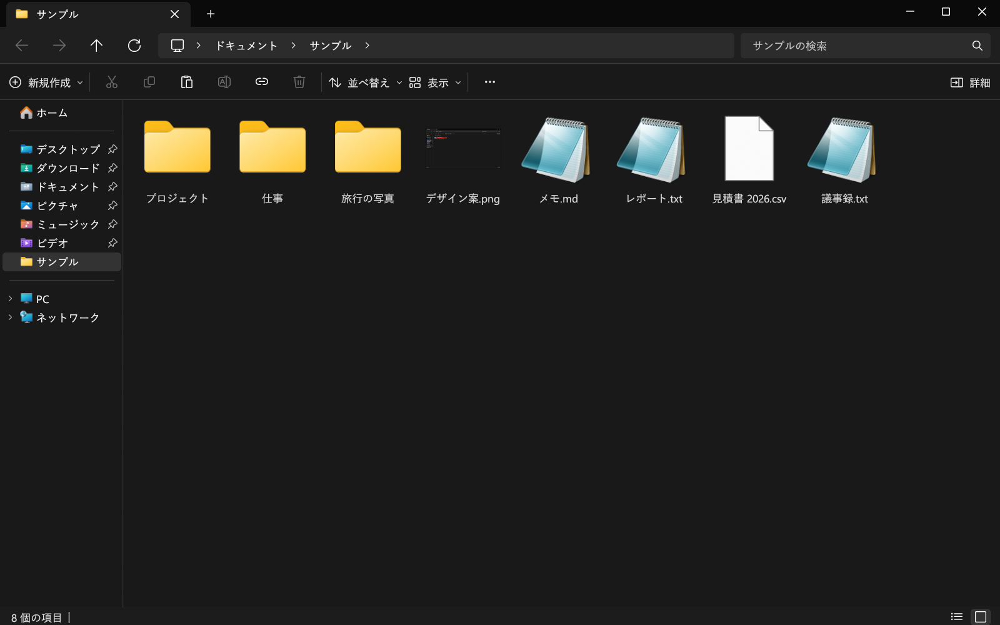

# Swift Explorer

[English](README.md) · [Türkçe](README.tr.md) · [简体中文](README.zh-CN.md)

Windows 11 のエクスプローラーと同じ見た目・同じ操作のファイル マネージャーです。Rust 製で、Windows と Linux で動きます。フォルダーはバックグラウンドのスレッドで読み込むので、大きなフォルダーを開いてもウィンドウが固まりません。検索はサブフォルダーを並列で調べます。



## ダウンロード

[Releases](../../releases) ページから `SwiftExplorer.exe` をダウンロードしてください。exe 1 つだけで、インストールは不要です。Windows 11 向けに作っています。Windows 10 でも動くはずですが、まだ試していません。

[Scoop](https://scoop.sh) の場合:

```powershell
scoop bucket add misutesu https://github.com/misutesu-desu/scoop-bucket
scoop install swift-explorer
```

Linux でのインストール方法は[英語の README](README.md#download) にあります。

## できること

- エクスプローラーと同じレイアウト: タイトル バーのタブ、パンくずリスト付きのアドレス バー、コマンド バー、ナビゲーション ウィンドウ、ホームと PC のページ。
- アイコン、サムネイル、ファイルの種類名は Windows のものをそのまま使います。
- エクスプローラーのショートカットはすべて同じように使えます。F1 で一覧を表示します。
- Ctrl+Shift+P でコマンド パレットが開きます。`隠し` や `大アイコン` のようにコマンド名の一部を入力して Enter を押します。
- Ctrl+Shift+S で 2 つのフォルダーを並べて表示します。F6 で切り替え、間でドラッグするとファイルをコピーまたは移動します。
- 複数の項目を選択して F2 を押すと一括で名前を変更できます。検索と置換、`{name}`・`{n}`・`{date}` を使う名前のパターン、大文字と小文字の変換に対応し、新しい名前を事前に一覧で確認できます。
- 右クリック メニューから ZIP ファイルを展開・作成できます。
- 検索結果は一覧の上のボタンで拡張子ごとに絞り込めます。
- 詳細ウィンドウには選択したフォルダーの中身が表示され、git リポジトリ内のフォルダーではステータス バーにブランチ名が表示されます。
- 検索ボックスに入力すると今のフォルダーをすぐに絞り込みます。Enter ですべてのサブフォルダーを検索し、`*` と `?` のワイルドカードも使えます。
- アドレス バーに `cmd`、`powershell`、`pwsh`、`wt` と入力すると、今のフォルダーでそのターミナルが開きます。
- コピー、切り取り、貼り付け、ドラッグ アンド ドロップはエクスプローラーやデスクトップとの間でも使えます。
- Shift + 右クリックで Windows の完全なコンテキスト メニューが開くので、7-Zip や「送る」もそのまま使えます。
- 右クリック メニューには 7-Zip、WinRAR、Notepad++、送る など、Windows のメニューにあるアプリも表示されます。一番下の「この一覧を編集」で表示する項目を選べます。
- Ctrl+Z で名前の変更、移動、コピー、ごみ箱への削除を元に戻せます。
- 「表示 > テーマ」には、システム、ライト、ダークのほかに Catppuccin、Gruvbox、Everforest、Nord、Dracula、Tokyo Night、Rosé Pine、Solarized があります。
- コピーと移動は、ファイルがディスクに書き込まれるまで完了になりません。ターミナルで `sync` を実行するのと同じです。進行状況バーが消えたら USB メモリを抜いてかまいません。別のドライブへの移動では、元のファイルはそのあとで削除されます。
- Windows ではウィンドウを閉じてもアプリがバックグラウンドで待機するので、次に開くときはグラフィックドライバーの起動を待たずにすぐ表示されます。「表示 > サインイン時にバックグラウンドで起動」をオンにすると、再起動後の最初の起動も速くなります。
- Windows ではアプリが自動で更新されます。新しいバージョンを GitHub からダウンロードし、SHA-256 で確認してから、ウィンドウを閉じたときに切り替えます。Scoop でインストールした場合は `scoop update` に任せます。「表示 > 更新を自動でインストール」でオフにできます。
- 日本語・中国語・韓国語のファイル名はシステムの CJK フォントで表示されます。
- 表示言語: 日本語、English、Türkçe、Deutsch、Español、Français、Português (Brasil)、Русский、简体中文。Windows の表示言語に合わせて選ばれ、「表示 > 言語」で変更できます。

日本語訳はまだネイティブの方に確認してもらっていません。不自然なところがあれば [#7](../../issues/7) で教えてください。

## ビルド

Rust 1.82 以降が必要です。

```bash
cargo build --release
```

## ライセンス

[MIT](LICENSE)
