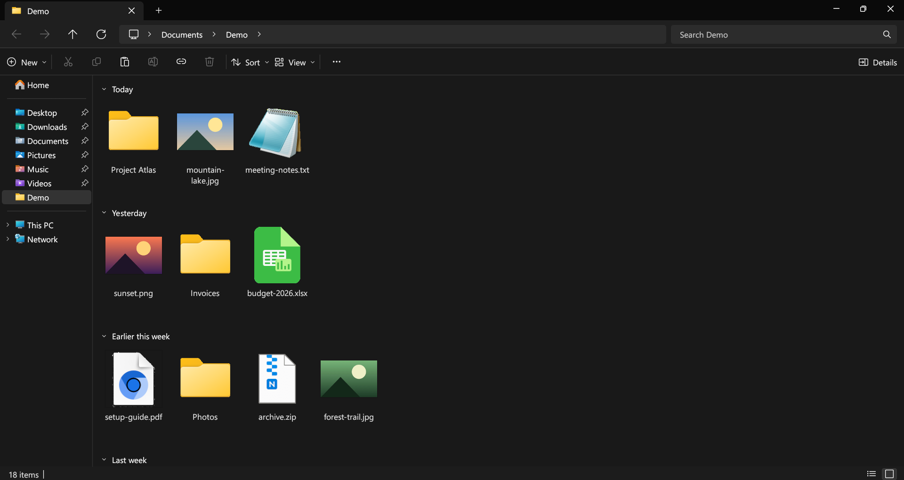
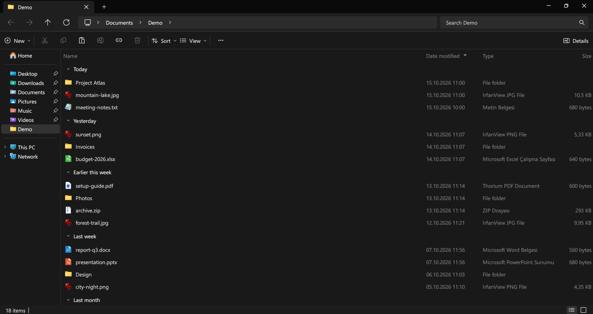
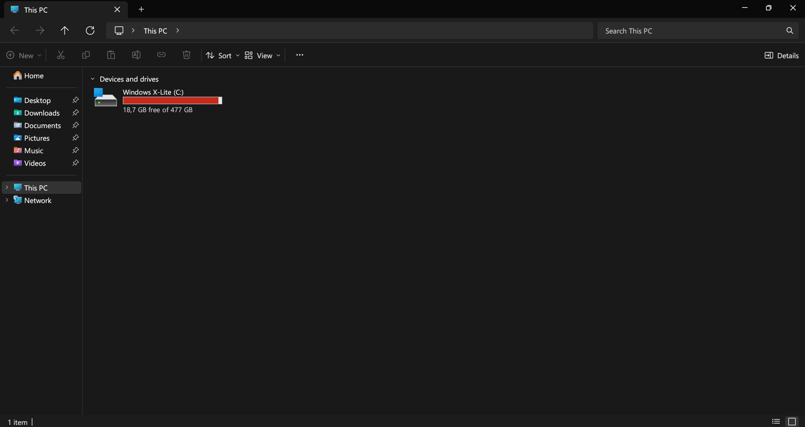
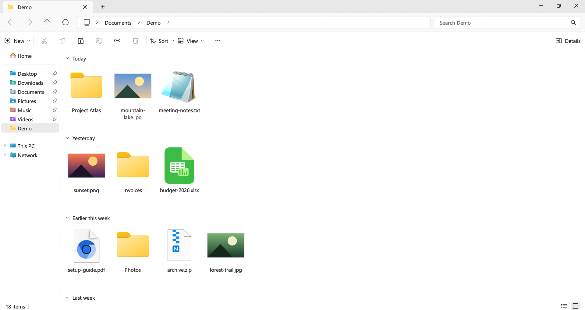

# Swift Explorer

[Türkçe](README.tr.md)

A file manager for Windows that looks and behaves like the Windows 11 File Explorer, written in Rust. Folders are read on background threads, so large ones open without freezing the window, and search runs across subfolders in parallel.



## Download

Get `SwiftExplorer.exe` from the [Releases](../../releases) page. It is a single file with no installer. Made for Windows 11; Windows 10 should work but hasn't been tested.

## What it does

- Same layout as Explorer: tabs in the title bar, address bar with breadcrumbs, command bar, navigation pane, Home and This PC pages.
- Uses Windows' own icons, thumbnails and file type names.
- Every Explorer shortcut works the same way. Press F1 for the full list.
- Typing in the search box filters the current folder instantly. Press Enter to search all subfolders; `*` and `?` wildcards work.
- Copy, cut, paste and drag and drop work in both directions with Explorer and the desktop.
- Shift + right-click opens the full Windows context menu, so 7-Zip, WinRAR and Send to are there.
- Ctrl+Z undoes renames, moves, copies and deletes to the Recycle Bin.
- When a file with the same name already exists, it asks whether to replace, skip or keep both.
- Folders update live when files change on disk.
- Downloads is grouped by date modified (Today, Yesterday, Last week…), like in Explorer. Other folders can be grouped from Sort > Group by.
- English and Turkish interface. The language follows Windows and can be changed from View > Language.

| Details | This PC |
| --- | --- |
|  |  |

| Light theme | Turkish |
| --- | --- |
|  |  |

The Type column and the Shift + right-click menu come from Windows, so they stay in the Windows display language even when the app is set to English.

## Building

You need Rust 1.82 or newer and Windows.

```bash
cargo build --release
```

The executable ends up in `target/release/swift-explorer.exe`.

## Settings

Settings are stored in `%APPDATA%\SwiftExplorer\config.json`. Setting the `SWIFT_EXPLORER_LANG` environment variable to `en` or `tr` overrides the language setting.

## Known limitations

- In Details view, the selection rectangle can only be started from the empty area below the rows.
- Windows can't move files with very long paths (around 260+ characters) to the Recycle Bin, so they are deleted directly and Ctrl+Z can't bring them back.
- Network locations open in Windows File Explorer.

## License

[MIT](LICENSE)
