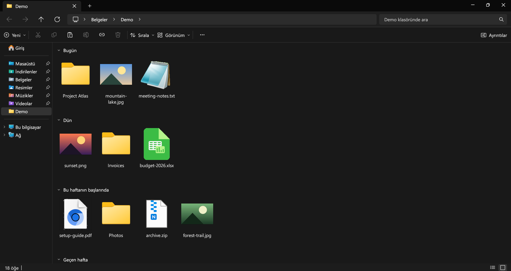

# Swift Explorer

[](../../releases/latest)
[](../../actions/workflows/build.yml)
[](LICENSE)

[English](README.md) · [简体中文](README.zh-CN.md) · [日本語](README.ja.md)

Windows 11 Dosya Gezgini'nin görünümünde ve davranışında, Rust ile yazılmış bir dosya yöneticisi. Windows ve Linux'ta çalışır. Klasörler arka planda okunduğu için büyük klasörler pencereyi dondurmadan açılır; arama alt klasörlerde paralel yapılır.



## İndirme

`SwiftExplorer.exe` dosyasını [Releases](../../releases) sayfasından indirin. Tek dosyadır, kurulum gerektirmez. Windows 11 için yapıldı; Windows 10'da da çalışması gerekir ama denenmedi.

[Scoop](https://scoop.sh) ile:

```powershell
scoop bucket add misutesu https://github.com/misutesu-desu/scoop-bucket
scoop install swift-explorer
```

Linux'ta kendi kullanıcınız için şu komutla kurabilirsiniz:

```bash
curl -fsSL https://raw.githubusercontent.com/misutesu-desu/swift-explorer/main/install.sh | sh
```

`swift-explorer` dosyası `~/.local/bin` klasörüne kopyalanır ve uygulama menüsüne eklenir. Kaldırmak için aynı komutta `sh`'den sonra `-s -- --uninstall` yazın. Kurmadan denemek isterseniz `swift-explorer-linux-x86_64.tar.gz` dosyasını indirip içindeki `swift-explorer`'ı açabilirsiniz.

0.2.0'dan sonraki sürümlerde `swift-explorer.flatpak` da var: `flatpak install --user swift-explorer.flatpak` ile kurulur.

## Neler var

- Explorer'la aynı düzen: başlık çubuğunda sekmeler, kırıntılı adres çubuğu, komut çubuğu, gezinti bölmesi, Giriş ve Bu bilgisayar sayfaları.
- Windows'un kendi ikonları, küçük resimleri ve tür adları kullanılır.
- Explorer'daki kısayolların hepsi aynı çalışır. F1 tam listeyi gösterir.
- Arama kutusuna yazdıkça bulunduğunuz klasör filtrelenir. Enter'a basınca tüm alt klasörlerde arar; `*` ve `?` joker karakterleri çalışır.
- Adres çubuğuna `cmd`, `powershell`, `pwsh` ya da `wt` yazınca o terminal bulunduğunuz klasörde açılır, `terminal` ise Windows Terminal'i açar. Linux'ta `terminal` varsayılan terminali, bir terminalin adı (`konsole`, `kitty`…) da o terminali açar.
- Kopyala, kes, yapıştır ve sürükle-bırak Explorer ve masaüstüyle iki yönlü çalışır.
- Shift + sağ tık Windows'un tam sağ tık menüsünü açar; 7-Zip, WinRAR ve Gönder orada.
- Ctrl+Z yeniden adlandırma, taşıma, kopyalama ve geri dönüşüm kutusuna silme işlemlerini geri alır.
- Hedefte aynı adlı dosya varsa değiştirmek, atlamak ya da ikisini de saklamak arasında seçim sorar.
- Diskteki değişiklikler açık klasörde anında görünür.
- İndirilenler, Explorer'daki gibi değiştirme tarihine göre gruplanır (Bugün, Dün, Geçen hafta…). Diğer klasörler Sırala > Grupla'dan gruplanabilir.
- Türkçe, İngilizce, Almanca, İspanyolca, Fransızca, Portekizce (Brezilya), Rusça, Çince (Basitleştirilmiş) ve Japonca arayüz. Dil Windows'a göre seçilir, Görünüm > Dil'den değiştirilebilir.
- Çince, Japonca ve Korece dosya adları sistemin CJK fontlarıyla görünür.

Diğer ekran görüntüleri [İngilizce README](README.md)'de.

Tür sütunu ve Shift + sağ tık menüsü Windows'tan gelir; uygulama İngilizceye alınsa da bunlar Windows'un dilinde kalır.

## Linux

Linux sürümü yeni ve Windows sürümü kadar denenmedi. Görünüm ve kısayollar aynı; farklar şunlar:

- İkonlar masaüstünün ikon temasından gelir. PNG, JPEG, GIF, WebP ve BMP için küçük resim gösterilir.
- Windows'un sağ tık menüsü yok; Shift + sağ tık ve Shift+F10 uygulamanın kendi menüsünü açar.
- Kopyalanan dosyalar panoya yol listesi olarak yazılır. Başka dosya yöneticilerinden kopyalanan yollar ve `file://` bağlantıları yapıştırılabilir; ters yönü çalışmayabilir.
- Pencereden dışarı sürükleme henüz yok. Pencereye dosya bırakmak X11'de çalışır.
- "Bu bilgisayar" sayfası `/` ve `/media`, `/run/media`, `/mnt` altına bağlanan diskleri gösterir.
- Özellikler ve "Dosya yöneticisinde göster", D-Bus üzerinden dosya yöneticinizi kullanır (Nautilus, Dolphin, Nemo ve Thunar destekler).

## Derleme

Rust 1.82 ya da daha yenisi gerekir.

```bash
cargo build --release
```

Çalıştırılabilir dosya Windows'ta `target/release/swift-explorer.exe`, Linux'ta `target/release/swift-explorer` konumuna yazılır.

## Çeviriler

Her dil [`src/i18n/`](src/i18n) içinde tek bir dosyadır. Yeni dil eklemek için `de.rs`'yi kopyalayın, her satırdaki ikinci metni çevirin, ardından [`src/i18n.rs`](src/i18n.rs) içine bir `mod` satırı ekleyip dili `LANGS`, `tables()` ve `system_lang()` içine yazın. Mevcut çevirilerdeki düzeltmeler de memnuniyetle karşılanır; henüz anadili bu diller olan biri kontrol etmedi.

## Ayarlar

Ayarlar Windows'ta `%APPDATA%\SwiftExplorer\config.json`, Linux'ta `~/.config/SwiftExplorer/config.json` dosyasında tutulur. `SWIFT_EXPLORER_LANG` ortam değişkenine bir dil kodu (`en`, `tr`, `de`, `es`, `fr`, `pt`, `ru`, `zh`, `ja`) verilirse dil ayarının önüne geçer.

## Bilinen sınırlar

- Ayrıntılar görünümünde seçim dikdörtgeni yalnızca satırların altındaki boş alandan başlatılabilir.
- Windows çok uzun yollardaki (yaklaşık 260+ karakter) dosyaları geri dönüşüm kutusuna taşıyamaz; bu dosyalar doğrudan silinir ve Ctrl+Z geri getiremez.
- Ağ konumları Windows Dosya Gezgini'nde açılır.

## Lisans

[MIT](LICENSE). Linux sürümü Microsoft'un [Fluent UI System Icons](https://github.com/microsoft/fluentui-system-icons) setinden birkaç ikon içerir ([MIT](assets/LICENSE-fluent-icons.txt)).
