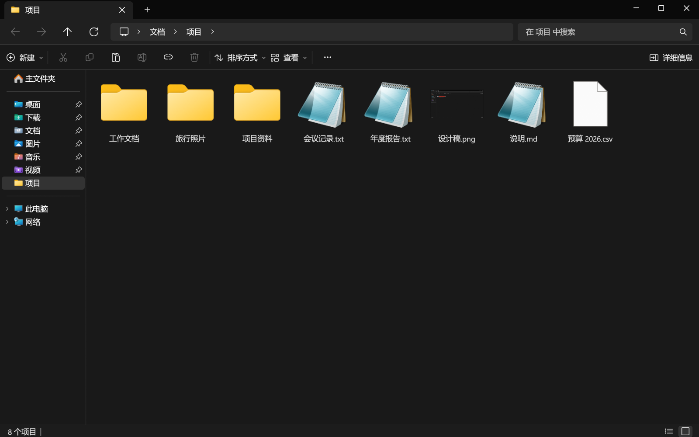

# Swift Explorer

[English](README.md) · [Türkçe](README.tr.md) · [日本語](README.ja.md)

一个外观和操作都与 Windows 11 文件资源管理器相同的文件管理器，用 Rust 编写，支持 Windows 和 Linux。文件夹在后台线程中读取，打开大文件夹时窗口不会卡住；搜索会并行扫描所有子文件夹。



## 下载

在 [Releases](../../releases) 页面下载 `SwiftExplorer.exe`。单个文件，无需安装。为 Windows 11 制作，Windows 10 应该也能运行，但尚未测试。

使用 [Scoop](https://scoop.sh)：

```powershell
scoop bucket add misutesu https://github.com/misutesu-desu/scoop-bucket
scoop install swift-explorer
```

Linux 的安装方法见[英文 README](README.md#download)。

## 功能

- 与资源管理器相同的布局：标题栏中的标签页、带路径导航的地址栏、命令栏、导航窗格、主文件夹和“此电脑”页面。
- 使用 Windows 自带的图标、缩略图和文件类型名称。
- 资源管理器的所有快捷键用法相同，按 F1 查看完整列表。
- 在搜索框中输入时即时筛选当前文件夹；按 Enter 搜索所有子文件夹，支持 `*` 和 `?` 通配符。
- 在地址栏输入 `cmd`、`powershell`、`pwsh` 或 `wt`，会在当前文件夹打开对应的终端。
- 复制、剪切、粘贴和拖放可与资源管理器及桌面双向互通。
- Shift + 右键打开完整的 Windows 右键菜单，7-Zip、WinRAR 和“发送到”都在其中。
- Ctrl+Z 可撤消重命名、移动、复制以及删除到回收站。
- “查看 > 主题”中除了系统、浅色、深色，还有 Catppuccin、Gruvbox、Everforest、Nord、Dracula、Tokyo Night、Rosé Pine 和 Solarized。
- 复制和移动要等文件真正写入磁盘后才算完成，相当于在终端里执行 `sync`。进度条消失后就可以拔出 U 盘。移动到其他驱动器时，原文件也是在此之后才删除。
- 在 Windows 上关闭窗口后，应用会在后台等待，再次打开时窗口立即出现，不必等显卡驱动启动。勾选“查看 > 登录时在后台启动”后，开机后的第一次打开也很快。
- 在 Windows 上应用会自动更新：新版本从 GitHub 下载，校验 SHA-256 后在关闭窗口时生效。通过 Scoop 安装时由 `scoop update` 负责更新。可在“查看 > 自动安装更新”中关闭。
- 中文、日文和韩文文件名使用系统的 CJK 字体正常显示。
- 界面语言：简体中文、English、Türkçe、Deutsch、Español、Français、Português (Brasil)、Русский、日本語。默认跟随 Windows 显示语言，可在“查看 > 语言”中更改。

简体中文翻译还没有母语者校对过。如果发现不自然的地方，欢迎在 [#6](../../issues/6) 中指出。

## 构建

需要 Rust 1.82 或更高版本。

```bash
cargo build --release
```

## 许可证

[MIT](LICENSE)
